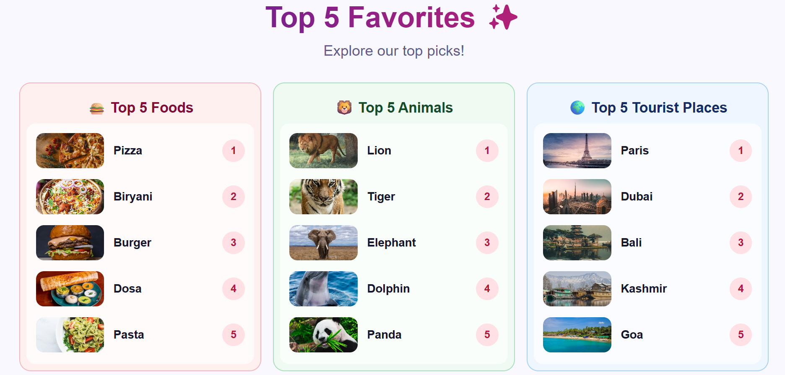

# FAVORITES

### A Collection of Things Worth Remembering.

A modern frontend web application built with React and Vite, designed with a clean interface, thoughtful styling, and a seamless user experience.

---

## About the Project

Favorites is a frontend development project that combines modern web technologies with a minimal and visually appealing design. It follows a component-based architecture, focusing on maintainability, simplicity, and presentation.

## Technology Stack

<p>
  
  
  
  
</p>

## Project Structure

```text
Favorites/
│
├── public/
│   ├── favicon.svg
│   └── icons.svg
│
├── screenshots/
│   └── favorites-preview.png
│
├── src/
│   ├── assets/
│   ├── App.jsx
│   ├── App.css
│   ├── index.css
│   └── main.jsx
│
├── eslint.config.js
├── index.html
├── package.json
├── package-lock.json
└── vite.config.js
```

## Application Preview

<p align="center">
  
</p>

## Getting Started

### 1. Clone the Repository

```bash
git clone https://github.com/Shashank74831/Favorites.git
```

### 2. Navigate to the Project

```bash
cd Favorites
```

### 3. Install Dependencies

```bash
npm install
```

### 4. Run the Application

```bash
npm run dev
```

Open the local development URL displayed in your terminal.

## Available Scripts

| Command | Description |
|---|---|
| `npm run dev` | Start development server |
| `npm run build` | Generate production build |
| `npm run preview` | Preview production build |
| `npm run lint` | Run code quality checks |

## Future Enhancements

- Personalized user preferences
- Search and filtering functionality
- Persistent favorites storage
- User authentication
- Backend integration

## Developer

**Shashank**

[GitHub Profile](https://github.com/Shashank74831)

---

<p align="center">
  <b>Less clutter. More meaning.</b><br/>
  <sub>Designed with simplicity. Built with purpose.</sub>
</p>
